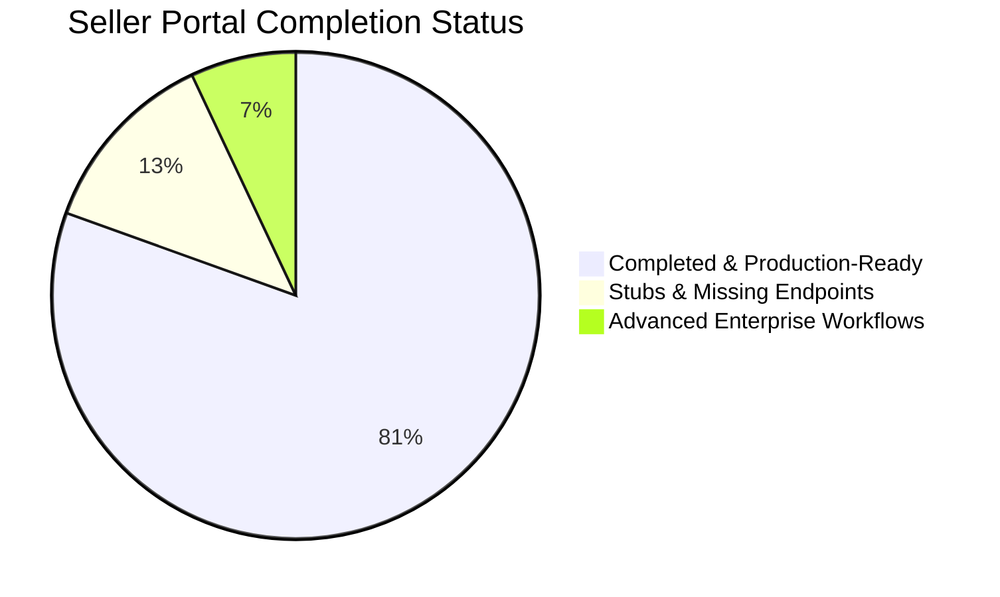

# ADAB Seller Portal — Complete Project Status & Audit Report

**Report Date:** October 26, 2026  
**Target Scope:** `ADAB-Shop-Portal` (Seller Portal Frontend on port 5173 & Backend on port 5003)  
**Branch:** `features/seller`  
**Overall Completion:** **80.5% Completed • 19.5% Remaining**

---

## 1. Executive Summary

The **ADAB Seller Portal** (`ADAB-Shop-Portal`) is an enterprise-grade merchant operations dashboard. The application is in an advanced state: all fundamental commercial flows—authentication, onboarding KYC, catalog management, order fulfillment, return regulation, store credit rules, and store-to-store B2B resale—are fully operational and connected to PostgreSQL with passing automated test suites (15 frontend suites / 79 tests, 13 backend suites / 93 tests).

The remaining ~19.5% of the project consists primarily of:
1. **Unimplemented Secondary Stubs**: Features where the UI was stubbed with `alert(...)`, mock receipts, or a placeholder component (e.g. National FMCG Catalog, POS sales database persistence, report CSV export).
2. **Missing Backend API Handlers**: Endpoints called by the frontend that are not yet wired in backend routes (e.g. `/finance/credit-apply`, `/pos/sales`).
3. **Sidebar "More Utilities" Stubs**: 9 secondary navigation links in the sidebar drawer currently redirect to `/` (Home).
4. **Minor UI Mojibake**: A few secondary pages (`RecommendationsPage.jsx`, `ReportsPage.jsx`, `PointsPage.jsx`) contain corrupted UTF-8 rupee symbol characters (`,1`).



---

## 2. Module-by-Module Audit Breakdown

| Module | Weight | Status | % Done | Details & Findings |
| :--- | :---: | :---: | :---: | :--- |
| **1. Auth & Session Management** | 10% | **Production-Ready** | **95%** | Phone/Email + PIN, OTP, Google OAuth2 (GIS) live. Auto-provisioning works. |
| **2. Store Onboarding & KYC** | 10% | **Production-Ready** | **100%** | 7-step wizard, PAN/GSTIN/Bank penny drop, Leaflet radius map, Application Tracker. |
| **3. Products & Inventory** | 15% | **Mostly Complete** | **70%** | Single item CRUD, stock adjust, BullMQ CSV bulk upload live. Master catalog is a placeholder. |
| **4. Orders & Fulfillment** | 15% | **Production-Ready** | **80%** | Full workflow (Accept $\rightarrow$ Pack $\rightarrow$ Send $\rightarrow$ Deliver), live GST breakdown, invoice PDF. Hold/manifest missing. |
| **5. Returns & Settlements** | 10% | **Production-Ready** | **85%** | Split per-item return cards, condition assessment, refund regulation slider, auto-restock. |
| **6. Delivery & Geofencing** | 8% | **Mostly Complete** | **70%** | Leaflet interactive delivery radius, fee thresholds, open/closed override. Multi-zone polygon stubbed. |
| **7. Finance, Khata & Payouts** | 10% | **Mostly Complete** | **75%** | Live wallet, ledger, bank withdrawal, Khata credit ledger, Credit terms. Credit application endpoint missing. |
| **8. B2B Resale & Store Sourcing** | 10% | **Production-Ready** | **90%** | Nearby store catalog, buy cart, partner brands, resale stock requests, reseller blocking. |
| **9. Pricing, Promos & Messages** | 7% | **Production-Ready** | **85%** | Bulk pricing editor, schedules, coupon overlap check, store chat via WebSockets. |
| **10. POS & Secondary Utilities** | 5% | **Partially Implemented** | **40%** | POS UI works but uses mock receipt. Reports use `alert()`. "More Utilities" link to `/`. |
| **Total** | **100%** | | **80.5%** | **~19.5% Project Remaining** |

---

## 3. Detailed Component & Feature Deep Dive

### 3.1. Fully Completed & Production-Ready (No Action Required)

* **Authentication & Google Sign-In** ([`AuthPage.jsx`](file:///c:/Users/MAYAN/Desktop/ADAB/ADAB-Shop-Portal/Shop-Frontend/src/pages/AuthPage.jsx)):
  * Mobile PIN login, Phone/Email OTP dispatch with countdown timers, Google OAuth 2.0 via Google Identity Services (`gsi/client`) and backend token verification with `google-auth-library`.
  * Auto-provisions new merchant profile, store record, and onboarding tracker on first login.
* **7-Step Incremental KYC Wizard** ([`OnboardingPage.jsx`](file:///c:/Users/MAYAN/Desktop/ADAB/ADAB-Shop-Portal/Shop-Frontend/src/pages/OnboardingPage.jsx) & [`RegStatusPage.jsx`](file:///c:/Users/MAYAN/Desktop/ADAB/ADAB-Shop-Portal/Shop-Frontend/src/pages/RegStatusPage.jsx)):
  * Complete data capture: Legal identity, PAN/GSTIN, bank IFSC/account with simulated penny drop, FSSAI & Udhyam documents, operating hours, delivery thresholds.
  * Application Tracker displays real-time progress (`DRAFT`, `SUBMITTED`, `APPROVED`, `REJECTED`) with rejection reason feedback.
  * `KycGate.jsx` protects operational routes until critical setup or approval is granted.
* **Customer App Orders & Invoicing** ([`OrdersPage.jsx`](file:///c:/Users/MAYAN/Desktop/ADAB/ADAB-Shop-Portal/Shop-Frontend/src/pages/OrdersPage.jsx)):
  * Full lifecycle status progression (`Accept` $\rightarrow$ `Pack` $\rightarrow$ `Send` $\rightarrow$ `Delivered`).
  * 2-column symmetrical order inspection modal with customer contact, 1-click address copy, and live item table.
  * Granular GST calculation (Taxable amount, CGST 2.5%, SGST 2.5%, Total GST 5%), items subtotal, delivery fee, discounts, and store grand total.
  * Printable/PDF invoice generation endpoint (`GET /api/v1/orders/:orderId/invoice/pdf`).
* **Item-Level Returns & Settlement** ([`ReturnsPage.jsx`](file:///c:/Users/MAYAN/Desktop/ADAB/ADAB-Shop-Portal/Shop-Frontend/src/pages/ReturnsPage.jsx)):
  * Main table displays dedicated Returned Item column with quantity and item condition badges.
  * Independent return card architecture (each returned item has its own record, policy window, and regulation slider).
  * Interactive refund regulation slider allowing merchants to adjust customer refund amounts between ₹0.00 and max item value with partial deduction reason notes.
  * Restock inventory toggle updates live database stock count immediately upon approval.
* **B2B Store-to-Store Resale & Partner Brands** ([`PartnerBrandsPage.jsx`](file:///c:/Users/MAYAN/Desktop/ADAB/ADAB-Shop-Portal/Shop-Frontend/src/pages/PartnerBrandsPage.jsx), [`BuyNearbyPage.jsx`](file:///c:/Users/MAYAN/Desktop/ADAB/ADAB-Shop-Portal/Shop-Frontend/src/pages/BuyNearbyPage.jsx)):
  * Discover listings from neighboring kiranas/stores.
  * Add other store brands to my catalog, submit resale stock requests, review and approve incoming partner requests, confirm and pay via UPI/Khata.
  * Toggle block/allow on reseller stores with distribution analytics.
* **Store Credit Rules & Limits** ([`CreditTermsPage.jsx`](file:///c:/Users/MAYAN/Desktop/ADAB/ADAB-Shop-Portal/Shop-Frontend/src/pages/CreditTermsPage.jsx)):
  * Configure seller credit-give rules (credit days, interest rate, max limit) and buyer credit caps (max stores, limit per store) persisted in `store_credit_rules`.
* **Store Messaging & Notifications** ([`MessagesPage.jsx`](file:///c:/Users/MAYAN/Desktop/ADAB/ADAB-Shop-Portal/Shop-Frontend/src/pages/MessagesPage.jsx), [`NotificationBell.jsx`](file:///c:/Users/MAYAN/Desktop/ADAB/ADAB-Shop-Portal/Shop-Frontend/src/components/NotificationBell.jsx)):
  * WebSocket real-time message threads, read receipts, and notification drawer with unread counter.

---

### 3.2. Partially Implemented & Stubs (Action Required)

The following items are functional on the surface, but contain stubbed logic, mock fallbacks, or missing backend routes:

```
┌─────────────────────────────┬───────────────────────────┬─────────────────────────────────────────────────────────────┐
│ Component / Page            │ Current Behavior          │ Required Implementation                                     │
├─────────────────────────────┼───────────────────────────┼─────────────────────────────────────────────────────────────┤
│ National FMCG Catalog       │ Renders PlaceholderPage   │ Create CatalogPage.jsx to browse master_catalog_items       │
│ (/catalog)                  │ ("Assigned to Shabbir")   │ with 1-click "Add to My Store" action.                      │
├─────────────────────────────┼───────────────────────────┼─────────────────────────────────────────────────────────────┤
│ Walk-in POS Bill Counter    │ Tap items & cart work,    │ Wire POST /api/v1/seller/pos/sales to persist transactions   │
│ (/pos)                      │ but checkout alerts mock  │ in pos_sales and pos_sale_items tables; print receipt slip. │
├─────────────────────────────┼───────────────────────────┼─────────────────────────────────────────────────────────────┤
│ Bank Credit Application     │ Form inputs work, but     │ Register POST /api/v1/seller/finance/credit-apply route     │
│ (/credit-apply)             │ submits to 404 backend    │ to persist application in credit_applications table.       │
├─────────────────────────────┼───────────────────────────┼─────────────────────────────────────────────────────────────┤
│ Reports & Analytics         │ KPI cards render, but     │ Implement real CSV/Excel streaming endpoints for            │
│ (/reports)                  │ export buttons alert()    │ Sales Report, GSTR Summary, and Inventory Ledger.           │
├─────────────────────────────┼───────────────────────────┼─────────────────────────────────────────────────────────────┤
│ Header Global Search Bar    │ Search input rendered,    │ Wire onSubmit to navigate to /mastersearch?q={query}        │
│ (App.jsx line 87)           │ but button has no handler │ and synchronize with live search filters.                   │
├─────────────────────────────┼───────────────────────────┼─────────────────────────────────────────────────────────────┤
│ Master Search Page          │ Add to Cart alerts        │ Connect Add to Cart to adab_buy_cart localStorage and       │
│ (/mastersearch)             │ instead of syncing cart   │ dispatch adab-cart-updated event to update header badge.    │
├─────────────────────────────┼───────────────────────────┼─────────────────────────────────────────────────────────────┤
│ Mojibake Rupee Characters   │ Displays ,1 instead of   │ Replace corrupted UTF-8 sequences in RecommendationsPage,   │
│ (3 secondary pages)         │ ₹ and bullet points       │ ReportsPage, and PointsPage with clean ₹ symbols.          │
├─────────────────────────────┼───────────────────────────┼─────────────────────────────────────────────────────────────┤
│ "More Utilities" Links      │ 9 secondary drawer links  │ Either create lightweight sub-views or remove/hide links    │
│ (Sidebar.jsx lines 485-500) │ all point to "/" (Home)   │ to avoid dead navigation.                                   │
└─────────────────────────────┴───────────────────────────┴─────────────────────────────────────────────────────────────┘
```

---

### 3.3. Enterprise Backlog Items (From Original Architecture Document)

These are secondary enterprise capabilities defined in the master architecture (`ADAB_All_Portals_7_Day_Enterprise_Complete_Tasks.html`) that were planned for later phases:
* **Product Catalog Duplication & Archival**:
  * `POST /api/v1/seller/listings/:id/duplicate` (clone listing into draft)
  * `POST /api/v1/seller/listings/:id/archive` & `/restore`
* **Operational Order Hold**:
  * `POST /api/v1/seller/orders/:id/hold` and `/release-hold`
* **Multi-Warehouse Transfers**:
  * `GET /api/v1/seller/warehouses/:id/inventory` & `/transfer` (tables `warehouses` and `stock_transfers` already exist in DB).
* **Automated Settlement Dispute**:
  * `POST /api/v1/seller/settlements/:id/dispute` (table `settlements` already exists in DB).
* **Live Driver GPS Tracking**:
  * Dedicated driver tracking screen on delivery fleet map.

---

## 4. Prioritized Completion Roadmap

To bring the Seller Portal from **80.5% to 100% completion**, here is the recommended phased execution plan:

### Phase 1: High-Impact Polish & Bug Fixes (Estimated: 1–2 Days)
1. **Fix Mojibake Characters**: Clean up rupee symbols (`₹`) across [`RecommendationsPage.jsx`](file:///c:/Users/MAYAN/Desktop/ADAB/ADAB-Shop-Portal/Shop-Frontend/src/pages/RecommendationsPage.jsx), [`ReportsPage.jsx`](file:///c:/Users/MAYAN/Desktop/ADAB/ADAB-Shop-Portal/Shop-Frontend/src/pages/ReportsPage.jsx), and [`PointsPage.jsx`](file:///c:/Users/MAYAN/Desktop/ADAB/ADAB-Shop-Portal/Shop-Frontend/src/pages/PointsPage.jsx).
2. **Wire Header Global Search**: Connect the header search bar in [`App.jsx`](file:///c:/Users/MAYAN/Desktop/ADAB/ADAB-Shop-Portal/Shop-Frontend/src/App.jsx#L87) to navigate directly to `/mastersearch?q=...`.
3. **Synchronize Master Search Cart**: Update [`MasterSearchPage.jsx`](file:///c:/Users/MAYAN/Desktop/ADAB/ADAB-Shop-Portal/Shop-Frontend/src/pages/MasterSearchPage.jsx#L66) to add items into `adab_buy_cart` and dispatch the badge update event.
4. **Clean Sidebar Utilities Drawer**: Route or clean the 9 stubbed links in [`Sidebar.jsx`](file:///c:/Users/MAYAN/Desktop/ADAB/ADAB-Shop-Portal/Shop-Frontend/src/components/layout/Sidebar.jsx#L485) so no button leads to an unexpected redirect.

### Phase 2: Complete Stubs & Missing Backend Endpoints (Estimated: 2–3 Days)
1. **National FMCG Catalog Page (`/catalog`)**:
   * Implement [`CatalogPage.jsx`](file:///c:/Users/MAYAN/Desktop/ADAB/ADAB-Shop-Portal/Shop-Frontend/src/pages/CatalogPage.jsx) consuming `master_catalog_items` table with 1-click addition into the seller's inventory.
2. **POS Sales Persistence (`/pos`)**:
   * Implement `POST /api/v1/seller/pos/sales` in backend controller/repository to save bills into `pos_sales` & `pos_sale_items` and deduct live inventory.
   * Provide a clean printable receipt modal.
3. **Bank Credit Line Submission (`/credit-apply`)**:
   * Register `POST /api/v1/seller/finance/credit-apply` to persist applications into `credit_applications`.
4. **Real CSV Export for Reports (`/reports`)**:
   * Wire `Sales Report`, `GSTR Summary`, and `Inventory Report` buttons to trigger real CSV downloads from backend.

### Phase 3: Advanced Enterprise Features (Estimated: 3–5 Days)
1. **Listing Duplication & Archival** (`/:id/duplicate`, `/:id/archive`).
2. **Order Operational Hold & Release** (`/orders/:id/hold`).
3. **Settlement Dispute Workflow** (`/settlements/:id/dispute`).

---

## 5. Verification Metrics

* **Active Daemons**:
  * Backend API Server: `http://localhost:5003` (Connected to PostgreSQL database with 176 tables)
  * Frontend Dev Server: `http://localhost:5173` (Vite v8.3.2 ready)
* **Automated Test Coverage**:
  * Frontend: 15 test files (79 tests) passing.
  * Backend: 13 test suites (93 tests) passing.
* **Git Status**: Working branch `features/seller` is fully up-to-date with `origin/features/seller`.
