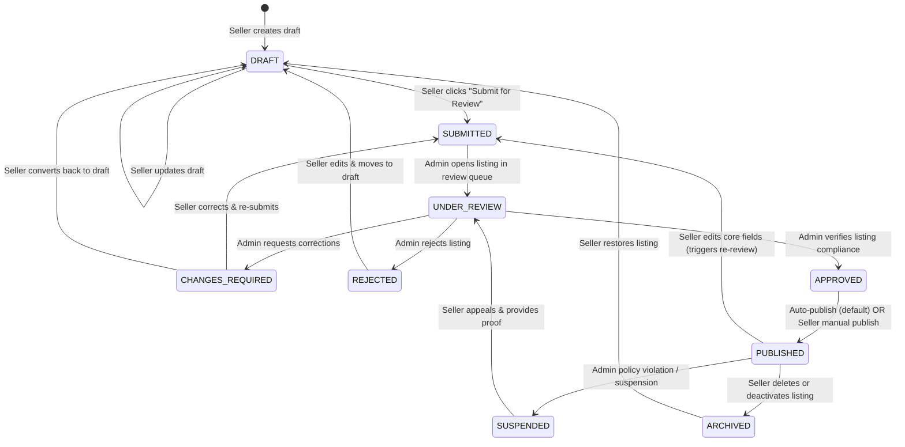
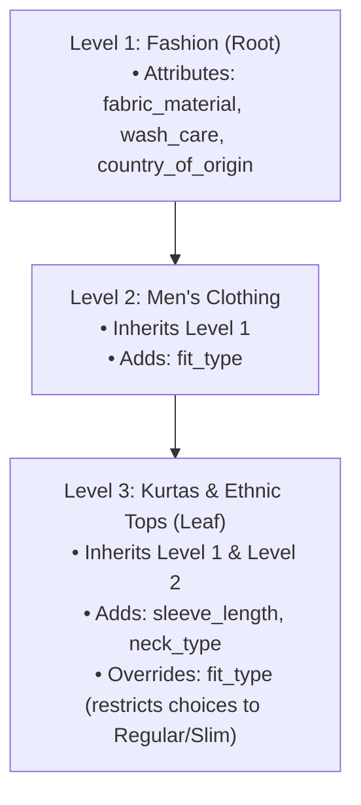

# ADAB B2C Catalog Architecture — Document 1
# Shop Portal Implementation Specification
**Target Team:** ADAB-Shop-Portal Engineering Team (Our Responsibility)  
**Target Codebase:** `ADAB-Shop-Portal/Shop-Backend` & `ADAB-Shop-Portal/Shop-Frontend`  
**Shared Database:** PostgreSQL (`adab_b2c_team`)  
**Version:** 2.0.0 (Production-Ready Architecture)

---

## 1. Document Scope & Shared Database Governance

This document defines the complete technical implementation specification for the **Shop Portal** (`ADAB-Shop-Portal`).

### 1.1 Team Ownership & Boundaries
* **Owned by Our Team**:
  * All application code in `ADAB-Shop-Portal/Shop-Frontend` (Add/Edit product modal, dynamic category cascader, dynamic attribute renderer, variant matrix canvas, archetype controls, barcode lookup UI).
  * All application code in `ADAB-Shop-Portal/Shop-Backend` (Listing routes, controller, service, Zod DTO validations, dynamic attribute schema resolution, barcode lookup endpoint, multi-tier catalog auto-population, variant persistence, concurrency-safe inventory operations).
  * Authoring, documenting, and packaging database migration scripts for the shared PostgreSQL database (`adab_b2c_team`).
* **Shared Database Governance Protocol**:
  * The PostgreSQL database (`adab_b2c_team`) is shared across Shop, Admin, and Customer portals.
  * **Rule**: While the Shop Portal team authors and prepares the SQL migration scripts (`migrations/004_catalog_dynamic_attributes_and_variants.sql`), **all schema changes must be reviewed and formally approved by Admin and Customer portal engineering leads before execution on production**.
  * No portal may unilaterally alter shared tables without coordination.

---

## 2. Standardized Listing Lifecycle State Machine

Across all three portals (Shop, Admin, and Customer), the listing status lifecycle is standardized to eliminate any inconsistency between `APPROVED` and `PUBLISHED`:



### 2.1 State Definitions & Portal Visibility

| Status Code | Meaning | Shop Portal (Seller View) | Admin Portal (Admin View) | Customer Portal (Public App) |
| :--- | :--- | :--- | :--- | :--- |
| **`DRAFT`** | Listing in progress; validation non-blocking. | Editable; marked "Draft". | Not visible in review queue. | **Hidden** (Not searchable, not purchasable). |
| **`SUBMITTED`** | Seller completed listing; awaiting admin review. | Locked / Read-only; marked "Under Review". | Visible in "Pending Approval" queue. | **Hidden**. |
| **`UNDER_REVIEW`**| Admin actively inspecting listing. | Read-only; marked "Under Review". | Assigned to active reviewing admin. | **Hidden**. |
| **`CHANGES_REQUIRED`**| Admin flagged specific attributes/images for correction. | Editable; highlights flagged attributes with admin reason. | Visible in "Changes Pending" tab. | **Hidden**. |
| **`REJECTED`** | Listing rejected due to compliance/policy violation. | Editable; displays rejection reason. | Visible in "Rejected" audit log. | **Hidden**. |
| **`APPROVED`** | Verified by admin; ready for distribution. | Action available: "Publish Listing" (if manual publish). | Marked "Approved". | **Hidden** (until transitioned to `PUBLISHED`). |
| **`PUBLISHED`** | Active, verified listing live on the marketplace. | Editable (editing core specs triggers re-review). | Marked "Live / Published". | **LIVE** (Searchable, filterable, purchasable). |
| **`SUSPENDED`** | Temporarily taken down by admin for investigation. | Locked; displays suspension notice. | Marked "Suspended". | **Hidden**. |
| **`ARCHIVED`** | Soft-deleted / deactivated by seller. | Visible in "Archived" tab; can be restored. | Marked "Archived". | **Hidden**. |

---

## 3. Inventory Architecture & Concurrency-Safe Operations

### 3.1 Parent Listing vs. Child Variant Stock
* **Rule for Multi-Variant Products (`has_variants = true`)**:
  1. The parent listing in `seller_listings` is a **non-purchasable catalog container**.
  2. Inventory is maintained **strictly at the child variant level** in `listing_variants.stock_qty`.
  3. The parent listing's `seller_listings.stock_qty` represents an **aggregate read-only roll-up**:
     $$\text{seller\_listings.stock\_qty} = \sum_{\text{active variants}} \text{listing\_variants.stock\_qty}$$
  4. Orders and cart items for variant products **must always reference `variant_id`**.
  5. **Zero Double Deduction**: Stock deduction occurs exclusively on `listing_variants`. The parent stock is updated solely as a summary cache, never deducted independently.
* **Rule for Standalone Products (`has_variants = false`)**:
  1. Inventory is maintained directly on `seller_listings.stock_qty`.
  2. Cart items and order items have `variant_id = NULL`.

### 3.2 Concurrency-Safe Atomic Stock Deduction
The legacy pattern `GREATEST(0, stock_qty - quantity)` silently oversold inventory during race conditions.
All inventory deductions across all portals must execute **atomic conditional updates**:

```sql
-- For Variant Items (Customer Checkout):
UPDATE listing_variants 
SET stock_qty = stock_qty - $1, updated_at = NOW() 
WHERE id = $2 AND stock_qty >= $1 AND is_active = true
RETURNING stock_qty;

-- For Standalone Listings:
UPDATE seller_listings 
SET stock_qty = stock_qty - $1, updated_at = NOW() 
WHERE id = $2 AND stock_qty >= $1 AND has_variants = false AND is_active = true
RETURNING stock_qty;
```

* **Handling Race Conditions**: If the query returns `rowCount === 0`, it indicates that another customer purchased the last units milliseconds earlier. The checkout transaction immediately rolls back with an `INSUFFICIENT_STOCK` error code, preventing overselling.

### 3.3 Fractional Decimal Quantities End-to-End
To support loose produce (rice, pulses, vegetables, spices sold by fractional weight):
* The following columns are standardized to `NUMERIC(12, 3)`:
  * `seller_listings.stock_qty`
  * `seller_listings.min_order_qty`
  * `listing_variants.stock_qty`
  * `cart_items.quantity`
  * `order_items.quantity`
  * `inventory.stock_quantity`
  * `inventory.reserved_quantity`
  * `inventory.available_quantity`
  * `inventory_transactions.quantity_change`
  * `inventory_transactions.quantity_after`
  * `inventory_reservations.quantity_reserved`
* **Unit Enforcement**:
  * **Discrete Units** (`pcs`, `pack`, `pair`, `set`, `box`, `bottle`, `can`, `pouch`): Input validation requires integer quantities: `quantity % 1 === 0`.
  * **Fractional Units** (`kg`, `g`, `litre`, `ml`, `meter`): Decimal quantities allowed with precision up to 3 decimal places (e.g. `0.250`, `0.500`, `1.750`).

---

## 4. Verified Database Schema & Migration Plan

### 4.1 Status of Existing Tables in Live PostgreSQL Database

| Table Name | Verified DB Status | Primary Key | Key Columns & Notes |
| :--- | :--- | :--- | :--- |
| **`categories`** | **EXISTS** (10 rows) | `id (int4)` | `name`, `slug`, `parent_id`. Currently 1 level deep; needs `level`, `materialized_path`, `is_leaf`. |
| **`seller_listings`** | **EXISTS** (8 rows) | `id (uuid)` | `store_id`, `product_type`, `title`, `mrp`, `sell_price`, `stock_qty (int4)`, `approval_status`. |
| **`master_catalog_items`** | **EXISTS** (49 rows) | `id (uuid)` | `barcode`, `product_name`, `brand_name`, `category_id`, `printed_mrp`, `standard_unit`, `default_image_url`. |
| **`manage_manufacturer_products`** | **EXISTS** (3 rows) | `id (int4)` | B2B manufacturer products: `product_name`, `sku`, `price`, `mrp`, `unit`, `stock_quantity`, `image_url`. |
| **`product_images`** | **EXISTS** (6 rows) | `id (uuid)` | `product_id (uuid)`, `image_url (text)`, `is_primary (bool)`. |
| **`inventory`** | **EXISTS** (6 rows) | `id (uuid)` | `listing_id`, `stock_quantity (numeric)`, `reserved_quantity (numeric)`, `available_quantity (numeric)`. |
| **`inventory_transactions`** | **EXISTS** (57 rows) | `id (uuid)` | `inventory_id`, `transaction_type`, `quantity_change (int4)`, `quantity_after (int4)`. |
| **`inventory_reservations`** | **EXISTS** (61 rows) | `id (uuid)` | `inventory_id`, `order_id`, `cart_id`, `quantity_reserved (int4)`, `expires_at`, `status`. |
| **`cart_items`** | **EXISTS** (78 rows) | `id (uuid)` | `cart_id`, `listing_id`, `quantity (numeric)`. Needs `variant_id`. |
| **`order_items`** | **EXISTS** (126 rows) | `id (uuid)` | `seller_order_id`, `listing_id`, `product_name`, `quantity (numeric)`, `unit_price`, `total_price`. Needs `variant_id`. |
| **`product_approval_history`** | **EXISTS** (25 rows) | `id (uuid)` | Verified in DB: `listing_id`, `admin_id`, `previous_status`, `new_status`, `rejection_reason`, `notes`, `action_at`. |
| **`search_synonyms`** | **EXISTS** (0 rows) | `id (uuid)` | Verified in DB: `primary_term`, `synonyms (text[])`, `language_code`, `is_active`, `created_at`. |
| **`listing_attributes`** | **EXISTS** (0 rows) | `id (uuid)` | `listing_id`, `attribute_key`, `attribute_value`. Replaced by `seller_listings.attributes JSONB`. |
| **`product_variants`** | **EXISTS** (0 rows) | `id (uuid)` | Legacy table referencing `master_catalog_items(id)`. Kept intact; `listing_variants` introduced for store listings. |

### 4.2 Migration Script: `migrations/seller/004_catalog_dynamic_attributes_and_variants.sql`

```sql
-- ============================================================================
-- MIGRATION: 004_catalog_dynamic_attributes_and_variants.sql
-- PREPARED BY: ADAB Shop Portal Team
-- REVIEW REQUIRED: Shop, Admin, and Customer Portal Leads
-- TARGET: adab_b2c_team (PostgreSQL)
-- ============================================================================

BEGIN;

-- 1. Upgrade categories table for N-level hierarchical navigation
ALTER TABLE categories ADD COLUMN IF NOT EXISTS level INT NOT NULL DEFAULT 1;
ALTER TABLE categories ADD COLUMN IF NOT EXISTS materialized_path VARCHAR(255);
ALTER TABLE categories ADD COLUMN IF NOT EXISTS is_leaf BOOLEAN NOT NULL DEFAULT true;
ALTER TABLE categories ADD COLUMN IF NOT EXISTS google_product_category_id INT;

-- Backfill existing root categories
UPDATE categories 
SET level = 1, materialized_path = id::text, is_leaf = true 
WHERE materialized_path IS NULL;

CREATE INDEX IF NOT EXISTS idx_categories_path ON categories(materialized_path);
CREATE INDEX IF NOT EXISTS idx_categories_leaf ON categories(is_leaf) WHERE is_active = true;

-- 2. Create category_aliases table for vernacular terms and search synonyms
CREATE TABLE IF NOT EXISTS category_aliases (
    id UUID PRIMARY KEY DEFAULT gen_random_uuid(),
    category_id INT NOT NULL REFERENCES categories(id) ON DELETE CASCADE,
    alias_term VARCHAR(128) NOT NULL,
    language_code VARCHAR(10) DEFAULT 'en',
    created_at TIMESTAMPTZ DEFAULT NOW(),
    UNIQUE(category_id, alias_term)
);

CREATE INDEX IF NOT EXISTS idx_cat_aliases_term ON category_aliases(alias_term);

-- 3. Create global attribute_definitions dictionary
CREATE TABLE IF NOT EXISTS attribute_definitions (
    id UUID PRIMARY KEY DEFAULT gen_random_uuid(),
    code VARCHAR(64) UNIQUE NOT NULL,            -- e.g. 'fabric_material', 'size', 'shelf_life_days'
    label VARCHAR(128) NOT NULL,                 -- e.g. 'Fabric / Material'
    description TEXT,                            -- Tooltip guidance for seller
    data_type VARCHAR(32) NOT NULL,              -- 'STRING', 'NUMBER', 'BOOLEAN', 'ENUM', 'MULTI_SELECT'
    ui_type VARCHAR(32) NOT NULL,                -- 'text', 'select', 'multiselect', 'radio', 'switch', 'number_with_unit'
    allowed_values JSONB DEFAULT '[]'::jsonb,    -- Array of strings for enum choices
    unit_options JSONB DEFAULT '[]'::jsonb,      -- Array of unit strings e.g. ['days', 'months']
    validation_regex VARCHAR(255),               -- Optional validation regex pattern
    created_at TIMESTAMPTZ DEFAULT NOW(),
    updated_at TIMESTAMPTZ DEFAULT NOW()
);

CREATE INDEX IF NOT EXISTS idx_attr_def_code ON attribute_definitions(code);

-- 4. Create category_attributes linking table with inheritance rules
CREATE TABLE IF NOT EXISTS category_attributes (
    id UUID PRIMARY KEY DEFAULT gen_random_uuid(),
    category_id INT NOT NULL REFERENCES categories(id) ON DELETE CASCADE,
    attribute_id UUID NOT NULL REFERENCES attribute_definitions(id) ON DELETE CASCADE,
    is_required BOOLEAN NOT NULL DEFAULT false,     -- Must be supplied on 'SUBMITTED'
    is_variant_key BOOLEAN NOT NULL DEFAULT false,  -- Used for size/color variations
    is_filter_facet BOOLEAN NOT NULL DEFAULT true,  -- Visible on customer search filters
    display_order INT NOT NULL DEFAULT 0,
    section_group VARCHAR(64) NOT NULL DEFAULT 'Specifications', -- 'General', 'Technical', 'Compliance'
    created_at TIMESTAMPTZ DEFAULT NOW(),
    UNIQUE(category_id, attribute_id)
);

CREATE INDEX IF NOT EXISTS idx_cat_attr_lookup ON category_attributes(category_id, display_order);

-- 5. Upgrade seller_listings table
ALTER TABLE seller_listings ADD COLUMN IF NOT EXISTS attributes JSONB NOT NULL DEFAULT '{}'::jsonb;
ALTER TABLE seller_listings ADD COLUMN IF NOT EXISTS description TEXT;
ALTER TABLE seller_listings ADD COLUMN IF NOT EXISTS has_variants BOOLEAN NOT NULL DEFAULT false;

-- Lossless conversion from INTEGER to NUMERIC(12, 3) to support fractional quantities
ALTER TABLE seller_listings ALTER COLUMN stock_qty TYPE NUMERIC(12, 3) USING stock_qty::numeric(12, 3);
ALTER TABLE seller_listings ALTER COLUMN min_order_qty TYPE NUMERIC(12, 3) USING min_order_qty::numeric(12, 3);

CREATE INDEX IF NOT EXISTS idx_seller_listings_attributes ON seller_listings USING GIN (attributes);
CREATE INDEX IF NOT EXISTS idx_seller_listings_barcode ON seller_listings(barcode) WHERE barcode IS NOT NULL;

-- 6. Ensure master_catalog_items has barcode index
CREATE INDEX IF NOT EXISTS idx_master_catalog_barcode ON master_catalog_items(barcode) WHERE barcode IS NOT NULL;

-- 7. Create listing_variants table for multi-variant products
CREATE TABLE IF NOT EXISTS listing_variants (
    id UUID PRIMARY KEY DEFAULT gen_random_uuid(),
    listing_id UUID NOT NULL REFERENCES seller_listings(id) ON DELETE CASCADE,
    sku VARCHAR(100) NOT NULL UNIQUE,
    barcode VARCHAR(100),
    mrp NUMERIC(12, 2) NOT NULL,
    sell_price NUMERIC(12, 2) NOT NULL,
    stock_qty NUMERIC(12, 3) NOT NULL DEFAULT 0,
    variant_attributes JSONB NOT NULL DEFAULT '{}'::jsonb, -- e.g. {"size": "XL", "color": "Navy Blue"}
    image_url TEXT,
    is_active BOOLEAN NOT NULL DEFAULT true,
    created_at TIMESTAMPTZ DEFAULT NOW(),
    updated_at TIMESTAMPTZ DEFAULT NOW()
);

CREATE INDEX IF NOT EXISTS idx_variants_listing ON listing_variants(listing_id);
CREATE INDEX IF NOT EXISTS idx_variants_sku ON listing_variants(sku);
CREATE INDEX IF NOT EXISTS idx_variants_attrs ON listing_variants USING GIN (variant_attributes);

-- 8. Upgrade inventory transaction & reservation tables for decimal quantities
ALTER TABLE inventory_transactions ALTER COLUMN quantity_change TYPE NUMERIC(12, 3);
ALTER TABLE inventory_transactions ALTER COLUMN quantity_after TYPE NUMERIC(12, 3);
ALTER TABLE inventory_reservations ALTER COLUMN quantity_reserved TYPE NUMERIC(12, 3);

-- Add optional variant_id to inventory table for variant-level tracking
ALTER TABLE inventory ADD COLUMN IF NOT EXISTS variant_id UUID REFERENCES listing_variants(id) ON DELETE CASCADE;
CREATE INDEX IF NOT EXISTS idx_inventory_variant ON inventory(variant_id);

-- 9. Add variant_id to cart_items and order_items
ALTER TABLE cart_items ADD COLUMN IF NOT EXISTS variant_id UUID REFERENCES listing_variants(id) ON DELETE SET NULL;
CREATE INDEX IF NOT EXISTS idx_cart_items_variant ON cart_items(variant_id);

ALTER TABLE order_items ADD COLUMN IF NOT EXISTS variant_id UUID REFERENCES listing_variants(id) ON DELETE SET NULL;
CREATE INDEX IF NOT EXISTS idx_order_items_variant ON order_items(variant_id);

-- 10. Create taxonomy_versions table for publish versioning
CREATE TABLE IF NOT EXISTS taxonomy_versions (
    id UUID PRIMARY KEY DEFAULT gen_random_uuid(),
    version_number INT NOT NULL DEFAULT 1,
    published_by UUID REFERENCES users(id),
    changelog TEXT,
    created_at TIMESTAMPTZ DEFAULT NOW()
);

-- 11. Create catalog_promotion_audit table to log promotions to master catalog
CREATE TABLE IF NOT EXISTS catalog_promotion_audit (
    id UUID PRIMARY KEY DEFAULT gen_random_uuid(),
    promoted_by UUID REFERENCES users(id),
    source_listing_id UUID REFERENCES seller_listings(id) ON DELETE SET NULL,
    master_catalog_id UUID REFERENCES master_catalog_items(id) ON DELETE CASCADE,
    promoted_barcode VARCHAR(100) NOT NULL,
    notes TEXT,
    created_at TIMESTAMPTZ DEFAULT NOW()
);

COMMIT;
```

---

## 5. Category Hierarchy Maintenance & Path Management

### 5.1 Materialized Path Standard
* The `materialized_path` stores the ancestor chain separated by dots:
  `DepartmentID.CategoryID.SubcategoryID` (e.g. `8.81.811`).
* Querying all descendants of Category 81:
  `WHERE materialized_path = '81' OR materialized_path LIKE '81.%' OR materialized_path LIKE '%.81.%'`
* Generating breadcrumb trail for Category 811:
  Query ancestor nodes whose IDs match `string_to_array(c.materialized_path, '.')::int[]`.

### 5.2 Category Operations & Tree Maintenance
1. **Node Insertion**:
   When child category `C` is created under parent `P`:
   * `C.level = P.level + 1`
   * `C.materialized_path = P.materialized_path || '.' || C.id`
   * Parent `P` is updated: `UPDATE categories SET is_leaf = false WHERE id = P.id`.
2. **Node Movement / Re-Parenting**:
   When category `C` is moved to a new parent `P_new`:
   * Old prefix: `C.materialized_path`
   * New prefix: `P_new.materialized_path || '.' || C.id`
   * Update `C` and all descendants:
     ```sql
     UPDATE categories 
     SET materialized_path = REPLACE(materialized_path, $old_prefix, $new_prefix),
         level = level + ($p_new_level + 1 - $c_old_level)
     WHERE materialized_path = $old_prefix OR materialized_path LIKE $old_prefix || '.%';
     ```
   * If old parent has no remaining children: `UPDATE categories SET is_leaf = true WHERE id = P_old.id`.
3. **Node Merging**:
   When consolidating Category `A` into Category `B`:
   * Move listings: `UPDATE seller_listings SET category_id = B.id WHERE category_id = A.id;`
   * Move aliases: `UPDATE category_aliases SET category_id = B.id WHERE category_id = A.id ON CONFLICT DO NOTHING;`
   * Soft-delete: `UPDATE categories SET is_active = false WHERE id = A.id;`

---

## 6. Dynamic Attribute Inheritance Engine

### 6.1 Top-Down Inheritance Hierarchy
Child categories automatically inherit all attributes attached to their ancestors:



### 6.2 Attribute Inheritance & Resolution Query
When a seller selects leaf category `811`, the backend resolves the complete inherited schema using a single query:

```sql
WITH RECURSIVE category_chain AS (
    -- Start at leaf
    SELECT id, parent_id, level, 1 AS depth_rank 
    FROM categories WHERE id = $1
    UNION ALL
    -- Climb to ancestors
    SELECT c.id, c.parent_id, c.level, cc.depth_rank + 1
    FROM categories c
    JOIN category_chain cc ON c.id = cc.parent_id
)
SELECT DISTINCT ON (ad.code)
    ad.id AS attribute_id,
    ad.code,
    ad.label,
    ad.description,
    ad.data_type,
    ad.ui_type,
    COALESCE(ca.allowed_values, ad.allowed_values) AS allowed_values,
    ad.unit_options,
    ad.validation_regex,
    ca.is_required,
    ca.is_variant_key,
    ca.is_filter_facet,
    ca.section_group,
    ca.display_order
FROM category_chain cc
JOIN category_attributes ca ON cc.id = ca.category_id
JOIN attribute_definitions ad ON ca.attribute_id = ad.id
ORDER BY ad.code, cc.depth_rank ASC; -- Depth rank ensures leaf overrides take precedence over root
```

### 6.3 Validation & Override Constraints
1. **Mandatory Rules**: A child category can change an optional ancestor attribute (`is_required = false`) to mandatory (`is_required = true`). However, a child category **cannot downgrade** an ancestor's mandatory regulatory requirement (e.g., FSSAI license in Food).
2. **Enum Restrictions**: A child category can provide a subset of `allowed_values` (e.g. Toddler Clothing restricts size choices to `0-3M, 3-6M, 6-12M`).

---

## 7. Packed Item Sourcing, Barcode Lookup & Promotion Architecture

### 7.1 Multi-Tier Sourcing Model
When a seller selects `PACKED_ITEM`, the system supports three sourcing tiers:
* **Tier 1 (B2B Registered Manufacturer)**: Product sourced from a verified manufacturer on the ADAB B2B Portal (`manage_manufacturer_products`).
* **Tier 2 (National FMCG Master Catalog)**: Product sourced from external distributors/mandis, matching our 5,000+ national catalog (`master_catalog_items`).
* **Tier 3 (Manual Entry Fallback - Zero Blocking)**: Product is unlisted/regional. Seller manually types name, barcode, brand, and MRP.

### 7.2 Strict Barcode Lookup Logic
* **Rule**: Manufacturer internal SKUs (e.g., `MFG-102`) must **never be treated as barcodes**.
* Barcode lookup only accepts standard numerical barcodes (8, 12, 13, 14 digits) matching official EAN/UPC standards:
  ```javascript
  const isBarcode = /^[0-9]{8,14}$/.test(barcode.trim());
  ```
* **Separation of Concerns**:
  * **Catalogue Verification (`is_catalog_verified: true`)**: Indicates that product specifications, barcode, and brand match a verified national/manufacturer record.
  * **Seller Listing Approval (`approval_status`)**: Represents the seller's store-level permission to sell that item (`DRAFT`, `SUBMITTED`, `APPROVED`, `PUBLISHED`).

### 7.3 Safe Promotion from Seller Listing to Master Catalog
When an admin promotes an unindexed packed item to `master_catalog_items`:
1. **Strict Own Brand Exclusion**: Abort if `product_type === 'OWN_BRAND'` (`400: Own Brand private label items cannot be promoted to shared master catalog`).
2. **Duplicate Detection & Idempotency**:
   ```sql
   -- Advisory lock on barcode to prevent race condition
   SELECT pg_advisory_xact_lock(hashtext('promo_' || $barcode));

   -- Check if barcode already exists
   SELECT id FROM master_catalog_items WHERE barcode = $barcode;
   ```
   * If barcode already exists: Update `seller_listings.master_catalog_id = existing_id` without creating a duplicate.
   * If barcode does not exist: Insert into `master_catalog_items`, copy primary image from `product_images`, and record promotion in `catalog_promotion_audit`.

---

## 8. Shop-Backend API Surface & Page-to-Table Mapping

### 8.1 Page-to-API-to-Table Mapping (Shop Portal)

| UI Component | User Action | Backend API Route | Shared DB Tables Accessed |
| :--- | :--- | :--- | :--- |
| **Category Picker Modal** | Opens category tree | `GET /api/v1/seller/listings/categories/tree` | `categories` (Reads `id`, `name`, `parent_id`, `materialized_path`, `is_leaf`) |
| **Category Autocomplete** | Types "sugar" | `GET /api/v1/seller/listings/categories/search?q=sugar` | `categories` JOIN `category_aliases` (Resolves leaf category) |
| **Dynamic Specs Panel** | Category selected | `GET /api/v1/seller/listings/categories/:id/attributes` | `category_attributes` JOIN `attribute_definitions` (Inherited schema) |
| **Barcode Scan Field** | Scans EAN barcode | `GET /api/v1/seller/listings/lookup-barcode?barcode=...` | `master_catalog_items`, `manage_manufacturer_products` (Strict barcode match) |
| **Catalog Auto-Fill Dropdown** | Searches FMCG items | `GET /api/v1/seller/listings/catalog/search?q=...` | `master_catalog_items`, `manage_manufacturer_products` (Filters out `OWN_BRAND`) |
| **Add Product Modal** | Clicks "Save as Draft" | `POST /api/v1/seller/listings` (`approval_status: 'DRAFT'`) | `seller_listings` (`attributes JSONB`), `listing_variants`, `product_images` |
| **Add Product Modal** | Clicks "Submit Review"| `POST /api/v1/seller/listings` + `POST /:id/submit` | `seller_listings` (`approval_status: 'SUBMITTED'`), `product_approval_history` |
| **Partner Brands Resale** | B2B Resale order | `POST /api/v1/seller/partner-brands/adopt` | `seller_listings` (Creates store listing referencing `original_listing_id`) |

---

## 9. Testing & Acceptance Criteria for Shop Portal

| Test ID | Area | Scenario | Expected Result |
| :--- | :--- | :--- | :--- |
| **TC-SP-01** | Lifecycle | Seller submits listing with missing required category attributes. | Backend rejects with `400 Bad Request` listing missing attributes. |
| **TC-SP-02** | Lifecycle | Seller saves draft with missing attributes. | Successfully saves listing with `approval_status: 'DRAFT'`. |
| **TC-SP-03** | Inventory | Seller creates Kurti with 3 sizes (10, 20, 30 units). | `seller_listings.stock_qty` displays 60; `listing_variants` stores 10, 20, 30. |
| **TC-SP-04** | Concurrency | Customer orders last 1 unit of a variant during race condition. | First request succeeds; second request fails with `INSUFFICIENT_STOCK`. |
| **TC-SP-05** | Decimals | Seller stocks `50.250 kg` of Basmati Rice. | Database stores exact `50.250` without rounding or type error. |
| **TC-SP-06** | Barcode | Seller scans `8901030383749` (Tata Salt). | Auto-fills Title, Brand (Tata), Barcode, MRP (₹28), Category (3), and Image. |
| **TC-SP-07** | Barcode | Seller enters manufacturer SKU `MFG-102`. | Does not treat SKU as barcode; prompts seller to enter standard EAN code. |
| **TC-SP-08** | Privacy | Seller searches catalog for another store's Own Brand Kurti. | Kurti is strictly excluded; private label remains isolated. |
